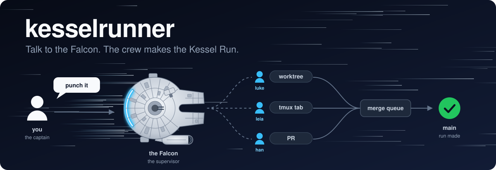

<div align="center">

# kesselrunner

**Talk to the Falcon. The crew makes the Kessel Run.**

[](LICENSE)
[](https://nodejs.org)
[](https://code.claude.com)

</div>



Run three coding agents at once and you become the switchboard: which tab asked a question, which branch is safe to merge, who touched what.
kesselrunner gives you one ship to talk to: the Falcon. It puts a crew member on each task, brings you only what needs you, and lands the work. Less than twelve parsecs from ask to merged PR.

## What it looks like

```text
you     › in acme: the settings form forgets edits on refresh, and reports need a CSV export. punch it.
Falcon  › yoda · settings form and leia · CSV export started, each in its own worktree and tmux tab.
Falcon  › leia asks: export every column, or only the visible ones?  [Visible only (Recommended)] [Every column]
you     › visible only
Falcon  › yoda · settings form: PR #214 green, landed through the merge queue.
Falcon  › leia · CSV export: PR #215 green, landed. Both runs made.
```

You are the captain. The Falcon is the ship you talk to, the workers are its crew (each task gets a name: yoda, leia, luke, han, chewie and on down the roster), each task is a run, and a merged PR is a run made. Never mind the odds: the merge queue lands only green PRs.

## Install

```bash
curl -fsSL https://raw.githubusercontent.com/eeshankulk1/kesselrunner/main/install.sh | bash
```

Needs git, Node 20+, [Claude Code](https://code.claude.com), tmux, and the GitHub CLI (`gh auth login`) for the PR steps.
The installer clones the core to `~/.kesselrunner`, puts `kesselrunner`, `rollcall` and `falcon` on your PATH, installs docsic, and applies the setup to `~/.claude`. What you already keep in `~/.claude` stays yours.

Then open a terminal tab and board the Falcon:

```bash
falcon
```

`falcon continue` comes back to the last one, and `falcon resume` picks one from the hangar. Every session start pulls the latest core, so there is nothing to update by hand.

## How it works

```text
you ──▶ the Falcon (supervisor) ──┬──▶ worker: worktree + tmux tab ──▶ PR ──┐
                                  ├──▶ worker: worktree + tmux tab ──▶ PR ──┼──▶ merge queue ──▶ main
                                  └──▶ worker: worktree + tmux tab ──▶ PR ──┘
        memory (docsic) and session awareness (rollcall) under every one of them
```

- **The Falcon, the supervisor.** The one session you type into. It turns each ask into a task, puts a crew member on it, brings the crew's questions to its own picker, and never edits code itself. More ships wait in the hangar: a second supervisor is the Venator, then the Ghost, each with its own crew.
- **The crew.** Each worker is an ordinary Claude Code session in its own git worktree and tmux tab, so tasks never share a checkout. Click a tab to watch one, or type `@leia <words>` to talk to it.
- **The ship chain.** `/pr-create` checks, reviews and documents the change, opens the PR and watches CI, with helper agents for review, tests and docs.
- **[rollcall](packages/rollcall/README.md).** Keeps every session aware of the others, holds the task records, and runs the merge queue: a script that lands green PRs in the order they became ready, as they are when they merge cleanly and otherwise in trains tested as the tree that lands.
- **[docsic](https://github.com/eeshankulk1/docsic).** Project memory. Where each project stands and what past sessions learned reach every new session without you asking.

Your own instructions, settings, skills and guards live in an [overlay](docs/overlay.md), a folder of yours that sync layers on top and never touches.
The same setup also runs in OpenAI Codex, and the helper agents can run on a Codex plan ([details](docs/codex-parity.md)).

## Read more

- [Principles](docs/principles.md) - why it works the way it does
- [Commands](docs/commands.md) - everything you type: `kesselrunner`, `falcon`, `rollcall`, the slash commands, the settings
- [Architecture](docs/architecture.md) - the parts, the repo layout, what it changes in `~/.claude`, the mods
- [Overlay](docs/overlay.md) - your personal layer: instructions, settings, skills, agents, rules and guards
- [rollcall](packages/rollcall/README.md) - sessions, tasks, supervisors and the merge queue in depth
- [docsic](https://github.com/eeshankulk1/docsic) - the memory layer, its own project
- [Project docs standard](docs/project-docs.md) and [test manifest](docs/test-manifest.md) - the conventions the agents keep in your repos

## Contributing

Changes to the shared skills, agents and instructions go through PRs on this repo. Once merged, everyone picks them up on their next session start.

## License

[MIT](LICENSE)
